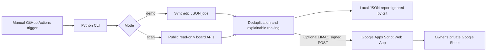

# Architecture | Open Job Agent

## Public vs private boundaries

- **Public repository:** code, tests, documentation, fictitious sample candidate and sample jobs.
- **Never committed:** real profile, boards you prefer to conceal, webhook URL, signing secret, CV, Google Spreadsheet data, execution reports, credentials.
- **GitHub Secrets for optional scan:** `OJA_PROFILE_JSON`, `OJA_SOURCES_JSON`, `OJA_APPS_SCRIPT_URL`, `OJA_HMAC_SECRET`.
- **Apps Script Script Properties:** only `OJA_HMAC_SECRET` (same value as the Actions secret) and `SPREADSHEET_ID` (generated by setup).
- **Application submission:** nonexistent. This project does NOT log in, send emails, fill forms or submit applications.

## Safety decisions

1. The GitHub workflow defaults to `demo` and **has no schedule**.
2. Live scans require explicitly configured sources, profile and optional sync credentials.
3. Sources only use a small allowlist of fixed-host, public, read-only API endpoints.
4. A SHA-256 HMAC with timestamp and one-use nonce authenticates POST payloads. The web app requires protected Script Properties and replay cache.
5. Upserts use the vacancy ID as deduplication key. Truncated, sanitized strings protect Sheet cells from formula injection.
6. The ranking is heuristic, not a qualification claim, verified salary, proof of geographic eligibility or probability of hiring.
7. Public GitHub Actions logs report **counts only**. Do not turn on shell debug traces or print reports/secrets.
8. Google Script deployment URL **must** be treated as private even though HMAC also protects ingestion.

## Out of scope / roadmap

- Human-approved applications and evidence tracking (not implemented).
- Gmail/Drive processing (not included, no OAuth scopes requested).
- Automated scheduled runs (intentionally disabled).
- Live end-to-end demonstration against a Google account (must be validated by repo owner).
